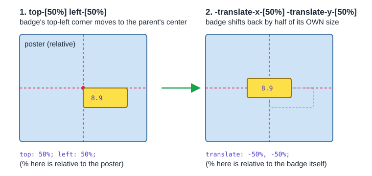

# Week 6 Lab: Movie Browser

## Before you start

This repo uses the **CodeRewind** VS Code extension to record your editing session (typed keystrokes, pastes, AI suggestion accepts) for later review. Set it up before you start coding:

1. Install the extension: open the **Extensions** view in VS Code (`Ctrl+Shift+X`), search for **CodeRewind**, and click **Install**. Or install it directly from the Marketplace: [https://marketplace.visualstudio.com/items?itemName=NabilMAl-Rousan.code-rewind](https://marketplace.visualstudio.com/items?itemName=NabilMAl-Rousan.code-rewind). If you have multiple VS Code profiles, right-click the extension and select **Apply Extension to all profiles**.
2. That's it! This repo already contains a `.coderewind-record` file at its root, so recording **starts automatically** the moment you open this folder in VS Code. A status bar item at the bottom right shows `CodeRewind: Recording` when it's active.
3. Just code normally. Sessions are saved to `.vscode/keylog/session-<timestamp>.jsonl` and are committed along with your other work (don't remove them or add `.vscode/keylog/` to your own `.gitignore`).
4. If you ever need to pause/resume recording manually, click the status bar item, or use **CodeRewind: Start Recording** / **CodeRewind: Stop Recording** from the Command Palette (`Ctrl+Shift+P`).

---

This lab builds on the movie-browser example from this week's lecture (DOM
selection, `fetch`, promises, `for...of`, template literals, and
`createElement`/`classList`). The lecture version fetches one page of movies
and renders them. This lab adds a few extra requirements on top of that:
**pagination with a "Load more" button, a "no more movies" message, and a
rating badge centered on top of each poster image.**

Fill in `script.js`. `index.html` is already done.

## Solution Demo

<https://comp1537-wk6-movies.netlify.app/>

<p align="center">
  <br>
  <em>Scrolling and clicking "Load more movies" appends another page of posters; searching resets to page 1, and a search with no matches shows the "No More movies" message.</em>
</p>

<!-- (solved source in [`solution/`](solution)) -->

## Setup

This is a standalone page: just open `index.html` in a browser, or serve the
folder with a local static server. There's no jQuery here, just plain DOM
APIs. `fetch()` calls a public movies API, so you'll need an internet
connection.

## Requirements

1. **Fetch movies.** Write `fetchYTS(searchQuery = "")`. Use `fetch()` with a
   template literal to call
   `https://movies-api.accel.li/api/v2/list_movies.json?genre=animation&sort_by=rating&query_term=${searchQuery}&page=${currentPage}`.
2. **Promise chain.** Chain two `.then()` calls: the first turns the response
   into JSON (`results.json()`), the second receives the parsed data.
   `console.log(results)` there so you can inspect the shape of the API
   response in DevTools. Add a `.catch()` to log any fetch errors.
3. **Loop & build elements.** Use a `for...of` loop over
   `results.data.movies`. For each movie, `document.createElement("div")`
   and set its `innerHTML` with a template literal showing the poster
   (`medium_cover_image`), title, and year.
4. **Centered rating badge.** On top of each poster image, show
   `element.rating` in a small badge that sits centered over the image (not
   just in a corner). See the Hints section below for how to do this with
   Tailwind utility classes.
5. **Pagination state.** Keep a `currentPage` variable starting at `1`.
   Only clear out `#main` (`main.innerHTML = ""`) when `currentPage === 1`;
   on later pages, new movies should be appended to the existing ones.
6. **Load more button.** After rendering a page of results, show a
   "Load more movies" button. Clicking it should increment `currentPage` and
   call `fetchYTS()` again with the current search text, appending the next
   page below the existing movies. Make sure clicking it repeatedly doesn't
   stack up multiple buttons.
7. **No more movies.** If the API responds with no `results.data.movies`
   (an empty page), show the `#noMore` message instead of trying to loop
   over `undefined`. Hide it again as soon as a search returns movies.
8. **Search input.** Use `#inp1`'s `"change"` event (fires when the field
   loses focus or you press Enter), not `"input"` (which fires on every
   keystroke). A new search should reset `currentPage` back to `1` before
   fetching, so pagination starts over.

## Pseudo-code

```js
let currentPage = 1;

function fetchYTS(searchQuery = "") {
  if (currentPage === 1) main.innerHTML = "";

  fetch(`...&query_term=${searchQuery}&page=${currentPage}`)
    .then((results) => results.json())
    .then((results) => {
      console.log(results);

      // if results.data.movies is missing: show #noMore and return
      // otherwise: hide #noMore

      for (const element of results.data.movies) {
        // create a div, fill it with poster + centered rating badge + title/year
        // append it to #main
      }

      // show (or re-create) the "Load more movies" button
    })
    .catch((err) => console.log(err));
}

fetchYTS();

// #loadMoreBtn click: currentPage++, fetchYTS(inp1.value)
// #inp1 change: currentPage = 1, fetchYTS(inp1.value)
```

## Hints

- **Centering the rating badge on the image.** Wrap the `` and the
  badge `<div>` together in a container with `class="relative"`. Give the
  badge `class="absolute top-[50%] left-[50%] -translate-x-[50%]
-translate-y-[50%]"`. `top`/`left` at `50%` position the badge's
  top-left corner at the image's center; the `-translate-x-[50%]
-translate-y-[50%]` then shifts the badge back by half of _its own_
  width/height, which is what actually centers it (percentages in `top`/
  `left` are relative to the parent, but percentages in `translate` are
  relative to the element itself):

  

- **Avoiding duplicate "Load more" buttons.** Before creating a new button,
  check `document.getElementById("loadMoreBtn")` and `.remove()` it if it
  exists, then create a fresh one and insert it with `main.after(btn)`.
- **Showing/hiding `#noMore`.** Toggle the `hidden` class:
  `noMore.classList.remove("hidden")` / `.add("hidden")`.
- `Array for(let i = 0; i < array.length; i++)` loops aren't required here, use `for...of` directly on
  `results.data.movies` to match the rest of the lecture's style.
- If the page looks blank after a search, check the Network/Console tab
  first: a typo in the query string is the most common cause.
